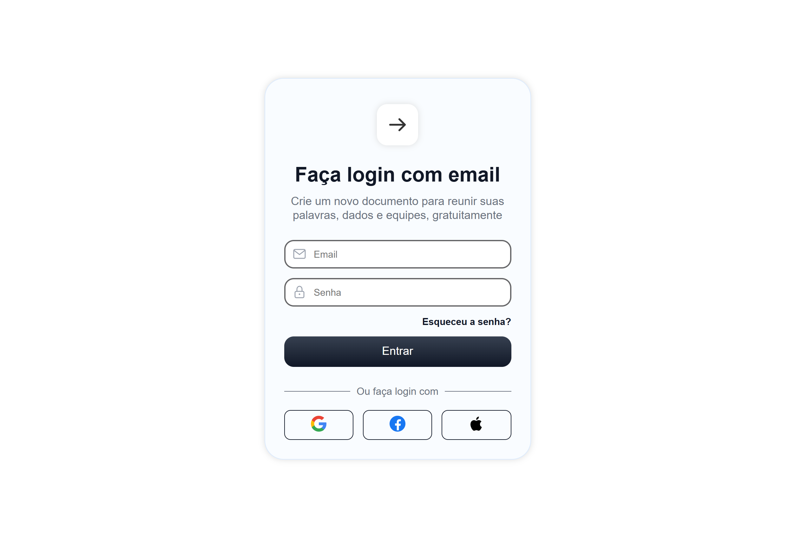
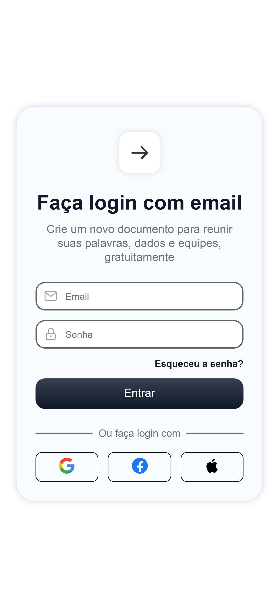

# Tela de Login | Levi Alencar

Tela de login responsiva feita com **HTML e CSS puros**. O projeto é um exercício de construção de interface: o foco foi montar um formulário bem estruturado, acessível e que se adapte a telas pequenas.

> **Importante:** este projeto é apenas visual. O formulário ainda não está conectado a um servidor, então o envio não autentica ninguém.

## Demonstração

- **Página publicada:** [COLE AQUI O LINK DO GITHUB PAGES]
- **Capturas de tela:**

| Computador | Celular |
|---|---|
|  |  |

## O que a tela tem

- **Formulário de login** com campos de e-mail e senha, validação nativa do navegador (`required` e `type="email"`) e senha mascarada.
- **Envio seguro por padrão:** o formulário usa o método `post`, então os dados não aparecem na barra de endereço.
- **Ícones dentro dos campos**, posicionados com `position: absolute` dentro de um container relativo.
- **Divisor "Ou faça login com"**, desenhado com os pseudo-elementos `::before` e `::after`.
- **Botões de login social** (Google, Facebook e Apple). Cada botão é um link inteiro, então a área clicável é todo o retângulo, e não só o ícone.
- **Layout responsivo:** o cartão ocupa a largura disponível até 420px, com ajuste de espaçamento em telas pequenas.

## Acessibilidade

- Os campos têm nome acessível (`aria-label`) e o atributo `autocomplete`, que ajuda os gerenciadores de senha.
- Os ícones decorativos têm `alt` vazio, e os botões sociais têm `alt` que descreve a ação ("faça login com Google").
- As cores de texto e as bordas dos campos foram conferidas quanto ao contraste.
- O idioma da página (`lang="pt-br"`) corresponde ao idioma do conteúdo.

## Tecnologias

- **HTML5:** estrutura semântica com `form`, `input` e `button`.
- **CSS3:** variáveis, Flexbox, `position`, pseudo-elementos, transições e `transform`.

## Estrutura do projeto

```
login/
├── index.html
├── style.css
├── script.js
├── img/          ícones dos campos e dos botões sociais
└── screenshots/  capturas de tela usadas neste README
```

## Como executar

1. Clone o repositório:
   ```
   git clone https://github.com/LeviAlencar-dev/NOME-DO-REPOSITORIO.git
   ```
2. Abra o arquivo `index.html` no navegador. Não há dependências nem etapa de instalação.

## O que pratiquei neste projeto

- Montar um formulário com os tipos de campo corretos (`email` e `password`) e entender por que valores inválidos de `type` viram texto comum.
- Entender a diferença entre os métodos `get` e `post` e o que cada um faz com os dados enviados.
- Dar **nome acessível** aos campos quando o design não tem rótulo visível.
- Posicionar elementos dentro de outros com `position: relative` e `absolute`.
- Criar um divisor com pseudo-elementos e Flexbox.
- Fazer do link o elemento clicável por inteiro.
- Escolher cores com **contraste suficiente** e usar **variáveis CSS** para organizar a paleta.
- Organizar as propriedades do CSS numa ordem consistente.

## Próximos passos

- [ ] Validação com JavaScript e mensagens de erro personalizadas
- [ ] Alternar a visibilidade da senha
- [ ] Conectar o formulário a um back-end de autenticação

## Autor

**Levi Alencar**, estudante de Ciência da Computação em formação Full Stack.

- LinkedIn: [linkedin.com/in/levi-alencar-4b5063429](https://www.linkedin.com/in/levi-alencar-4b5063429)
- GitHub: [github.com/LeviAlencar-dev](https://github.com/LeviAlencar-dev)
